<h1 align="left">👋 Hey, I'm Pooja S !</h1>

###

- 🎓 **B.E. CSE** student, Honours in **Data Science** · CGPA **8.64**.
- 🤖 I build **AI systems**: RAG pipelines, multi-agent workflows, semantic search, and ML classifiers.
- 📊 Comfortable across the data side too: cleaning and labeling datasets, training models, and evaluating them.
- 🏢 Backend Intern at **Hexaware** — FastAPI backend and a React Native app for an AI education platform.
- 💻 A **full stack developer** who likes shipping products people actually use.
- 🚀 Open to **AI/ML Engineer**, **Backend**, and **Full Stack** roles.
- ⚡ Fun fact: *Build things. Break things. Learn everything.*

###

 
<h3 align="left">📫 Wanna connect? Reach out on</h3>

###

   
   
   
  

###

<h3 align="left">🤖 AI, ML & Data Science</h3>

###

  
  
  
  
  
  
  
  
  
  
  

###

  
  
  
  
  
  
  

###

<h3 align="left">🌐 Frontend</h3>

###

  
  
  
  
  
  
  

###

<h3 align="left">🧠 Backend & API</h3>

###

  
  
  
  
  
  
  
  
  

###

<h3 align="left">🧮 Databases</h3>

###

  
  
  
  
  
  
  
  
  

###

<h3 align="left">🧰 Tools</h3>

###

  
  
  
  
  
  
  

###

<h3 align="left">💼 Experience</h3>

- **Hexaware Technologies** — Backend Intern · `Feb 2026 – Present`  
  Mobile AI education platform. FastAPI backend and React Native frontend.
- **FlyHigh Educational Institute** — Full Stack Intern · `Oct 2025 – Jan 2026`  
  [QuizFlow](https://eduflex-zeta.vercel.app/), a live quiz platform used by 100+ students.
- **Infosys Springboard** — Java Developer Intern · `Nov 2025 – Jan 2026`  
  Legal Aid Matching Platform. 5-member team, 3+ backend modules.
- **AVPS Technologies, USA** — Full Stack Intern · `Dec 2024 – Sep 2025`  
  VocalMart, a voice-search shopping platform, delivered end to end over 9 months.

###

<h3 align="left">🧠 AI & Data Science Projects</h3>

- **[Multi-Tenant RAG Platform](https://github.com/pooja-s6/multitenant-rag)** — document Q&A for many organizations on one deployment, where no tenant can ever retrieve another tenant's data.  
  `FastAPI` `PostgreSQL + pgvector` `Redis` `Sentence Transformers` `React` `Docker`
  - Permission-aware retrieval: chunks are filtered by tenant, role, department, and access level before they reach the LLM.
  - Answers come with citations, the model used, a cache flag, and latency.
  - Semantic cache in Redis, scoped per tenant and permission context, so repeated questions cost nothing.
  - Model routing sends simple questions to a small model and complex ones to a large model.
  - Dashboard for query volume, cache hit rate, average and P95 latency, tokens, cost, and cost saved.
- **[BugLens AI](https://github.com/pooja-s6/BuglensAI)** — a multi-agent system that turns raw bug reports and stack traces into triage decisions and fix suggestions.  
  `Python` `FastAPI` `LangChain` `FAISS` `BERT` `XGBoost` `Streamlit`
  - Seven specialized agents (parser, duplicate detector, retriever, classifier, root-cause analyzer, solution recommender, guardrail) coordinated by an orchestrator.
  - Duplicate detection with FAISS vector search over historical bugs.
  - Category and severity classification with BERT + XGBoost, plus ML-based effort estimation.
  - LLM root-cause analysis and patch suggestions grounded in retrieved past fixes.
- **TutorX** — tutoring chatbot for personalized student guidance. `FastAPI` `React Native` `PostgreSQL` `OpenAI`

###

<h3 align="left">🏗️ Full Stack Projects</h3>

- **[QuizFlow](https://eduflex-zeta.vercel.app/)** — real-time quizzes and live leaderboards for 100+ students. `React` `Firebase`
- **Legal Aid Matching Platform** — connects NGOs, lawyers, and citizens. `React` `Spring Boot` `PostgreSQL`
- **VocalMart** — shopping with voice search. `Spring Boot` `React` `MongoDB`

###

<h3 align="left">🏆 Highlights</h3>

- Cognizant Hackathon participant · 2026
- Smart India Hackathon internal round, VEC · 2025
- Java Foundation — Infosys Springboard · 2025
- AI Fundamentals and AI/ML Internship — IBM SkillsBuild · 2025
- AWS Solutions Architecture Simulation — Forage · 2025

###

 

<picture>
  <source media="(prefers-color-scheme: dark)" srcset="https://raw.githubusercontent.com/pooja-s6/pooja-s6/output/pacman-contribution-graph-dark.svg">
  <source media="(prefers-color-scheme: light)" srcset="https://raw.githubusercontent.com/pooja-s6/pooja-s6/output/pacman-contribution-graph.svg">
  
</picture>

###
